

  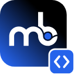

<h1 align="center">mBedLab Code Studio</h1>

  <b>One friendly app for MicroPython, Arduino (C++), block coding and a 3D robot world.</b> 
  Made for mBedLab boards, and it works with Arduino, Raspberry Pi Pico and many other boards too.

  
  
  

  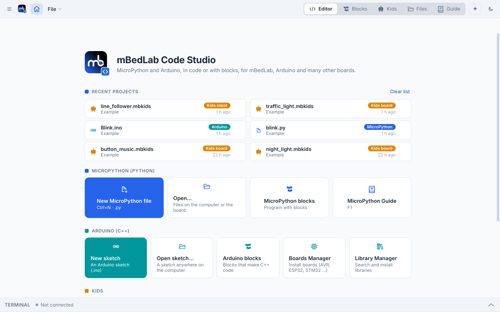

## Why mBedLab Code Studio?

Most tools do one thing: an editor for MicroPython, another for Arduino, a third for blocks, and
something else again for children. mBedLab Code Studio puts all of them in one window with one look,
so a learner can start with picture blocks, move on to blocks that show real code, and end up
writing MicroPython or C++ without ever changing tools.

- **Write MicroPython** and run it on the board with one click.
- **Build and upload Arduino sketches** with a full Boards and Library Manager.
- **Program with blocks** and watch the real code appear next to them.
- **Teach children** with big picture blocks, an on-screen board and a robot that drives in 2D and 3D.
- **Ask the AI assistant** for code or blocks in your own words.
- **Learn inside the app** with a Guide and step-by-step tours, in English and Persian.

## Download and install

1. Open the **[latest release](../../releases/latest)**.
2. Download `mBedLab.Code.Studio-<version>-Setup.exe`.
3. Run it and press **Install**.

The installer needs no administrator rights and brings everything the app needs. Nothing else has to
be installed. When a new version is published, the app tells you what is new and installs it for you.

  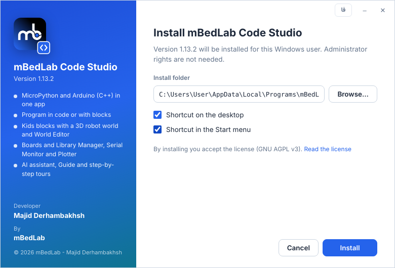

> The installer is not code-signed yet, so Windows SmartScreen may ask once:
> **More info > Run anyway**.

## Features

### MicroPython editor

Open a file, press **Run**, and see the result in the terminal. The editor knows the MicroPython
modules and completes them as you type. What you type in the terminal is shown in color, so it is
easy to tell your commands from the board's answers.

- Run, Stop and Reset with the run time on the toolbar
- Terminal (REPL) with copy, paste, save and text size
- File manager: copy files between the computer and the board, or sync a whole folder
- Install MicroPython firmware (.uf2) and MicroPython packages from inside the app
- Code snippets and ready examples

  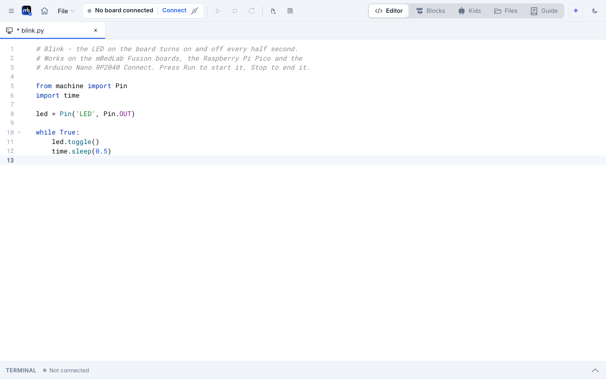

### Arduino (C++)

Open a `.ino` sketch and the toolbar turns into the Arduino tools: **Verify**, **Upload**,
**Serial Monitor** and **Serial Plotter**. The mBedLab board packages are built in, and any other
board can be added from the Boards Manager.

- Boards Manager and Library Manager: search, install, update, remove
- Build and upload progress with percent, problems marked on the code
- Serial Monitor with search, save and HEX view, and a live Serial Plotter
- Auto Format, examples from the board and its libraries, board options and programmers

<table>
  <tr>
    <td>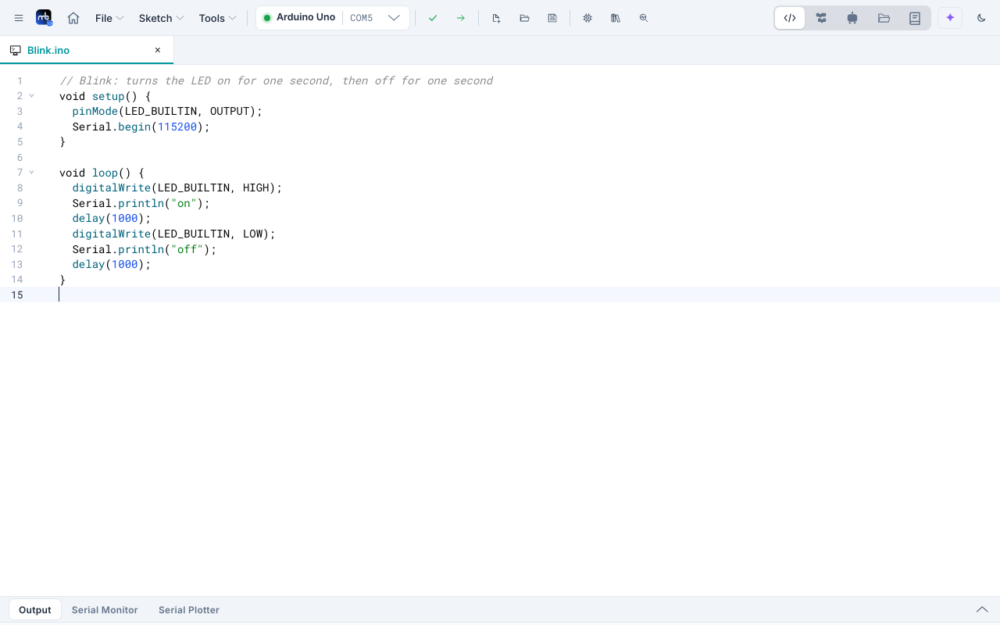</td>
    <td>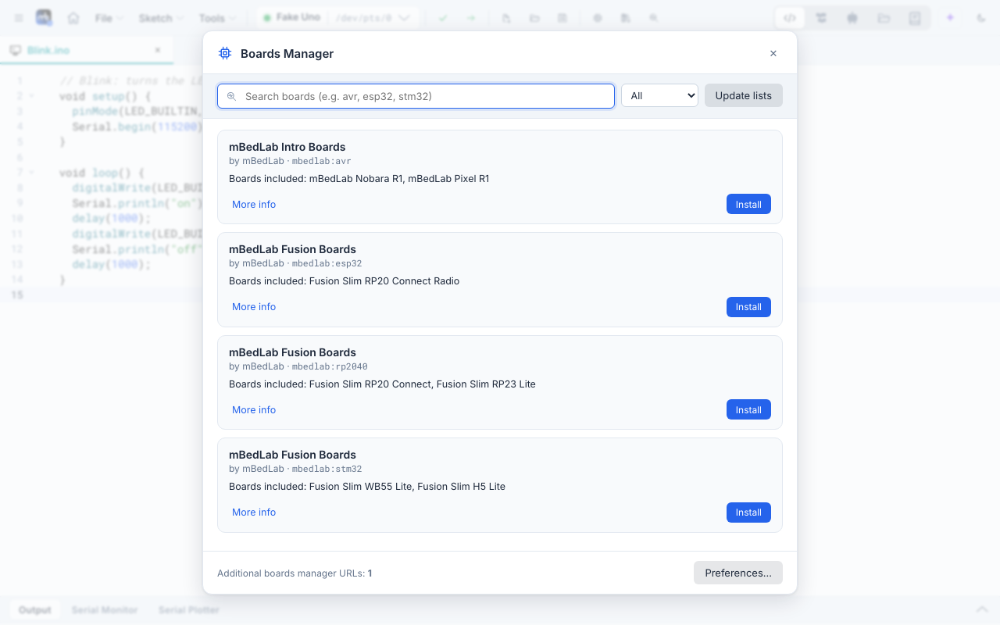</td>
  </tr>
</table>

### Blocks

Drag blocks together and the app writes real **MicroPython** or **Arduino C++** next to them. The
lines that change light up, so every block teaches a piece of code. Blocks cover pins, PWM, servos,
analog input, RGB LEDs, sensors, displays, radio, time, logic, loops, math, text, lists, variables
and functions.

<table>
  <tr>
    <td>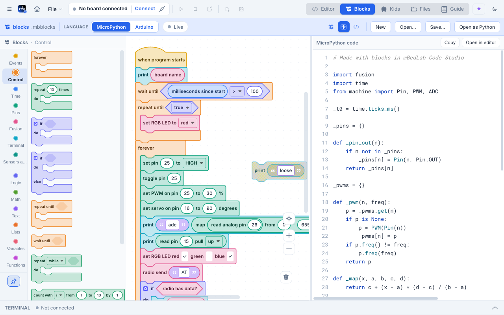</td>
    <td>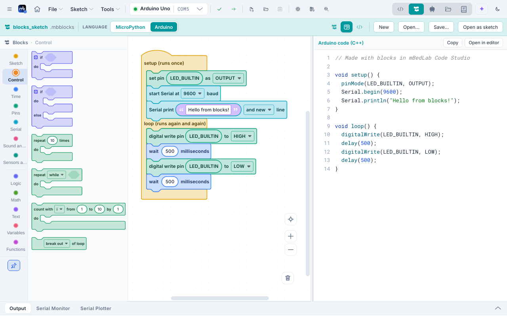</td>
  </tr>
</table>

### Kids

Big picture blocks for a first program. Children can light up an **on-screen board** that shows
which pins are in use, with no hardware needed, and then send the same program to a real board.

  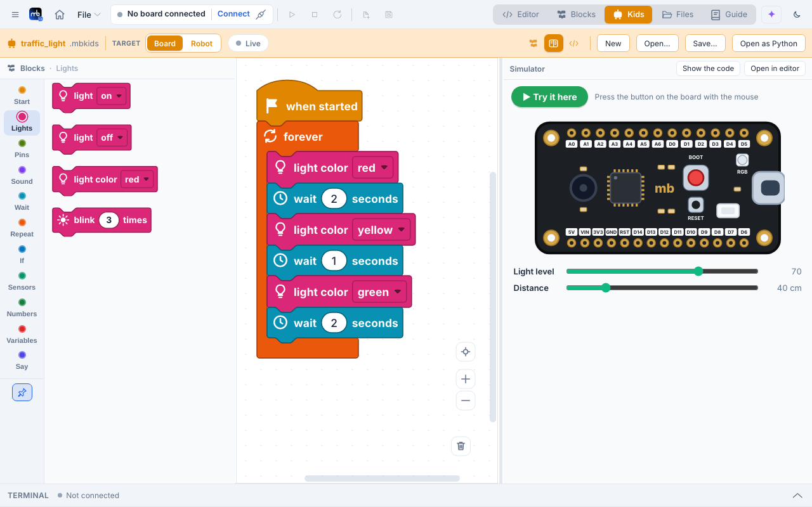

### Robot world in 2D and 3D

A robot on the screen follows lines, sees colors, avoids walls and draws with a pen. Switch between
**2D and 3D**, day and night, a park or Mars. Choose a wheel robot, a ball robot, a track robot or a
**drone** that flies over a city. Program it with blocks or with Python.

  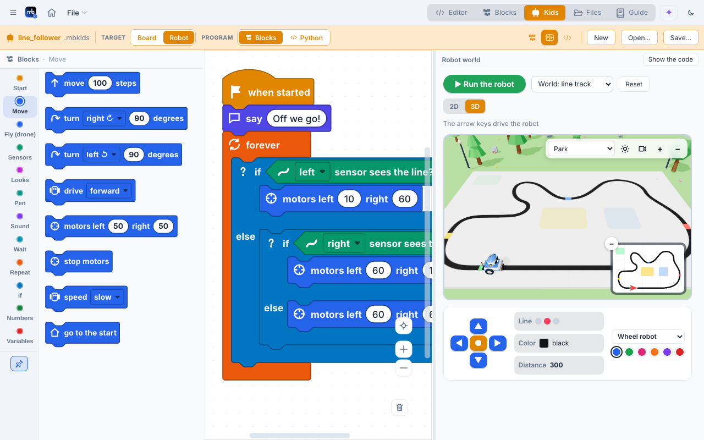

### World Editor

Build your own worlds for the robot: roads, rivers, buildings, bridges, ramps, hills, walls and
lines to follow. Edit in 2D or 3D, save your worlds, and try them with the robot right away.

  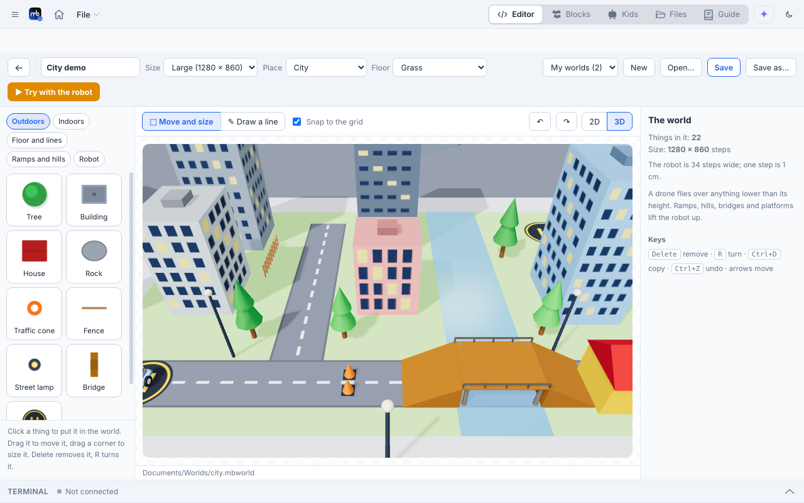

### AI assistant

Describe what you want, for example *"blink the LED twice a second"*, and the assistant writes the
MicroPython, the Arduino sketch or the blocks for you inside the app. It works with your own
account at Google Gemini, Claude, OpenAI, Groq, OpenRouter, Mistral, GitHub Models, Ollama, or any
OpenAI-compatible service. Keys are stored encrypted on your computer. An MCP server is included
for outside AI agents; it is off by default.

  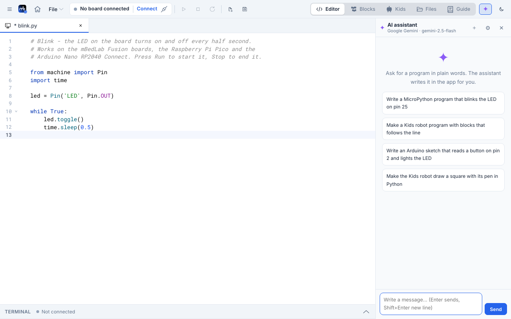

### Guide and tours

Press **F1** for the Guide: the Python language, the board modules, pin maps and examples that open
in the editor. New to the app? Pick a **tour** and it walks you through each part step by step.

  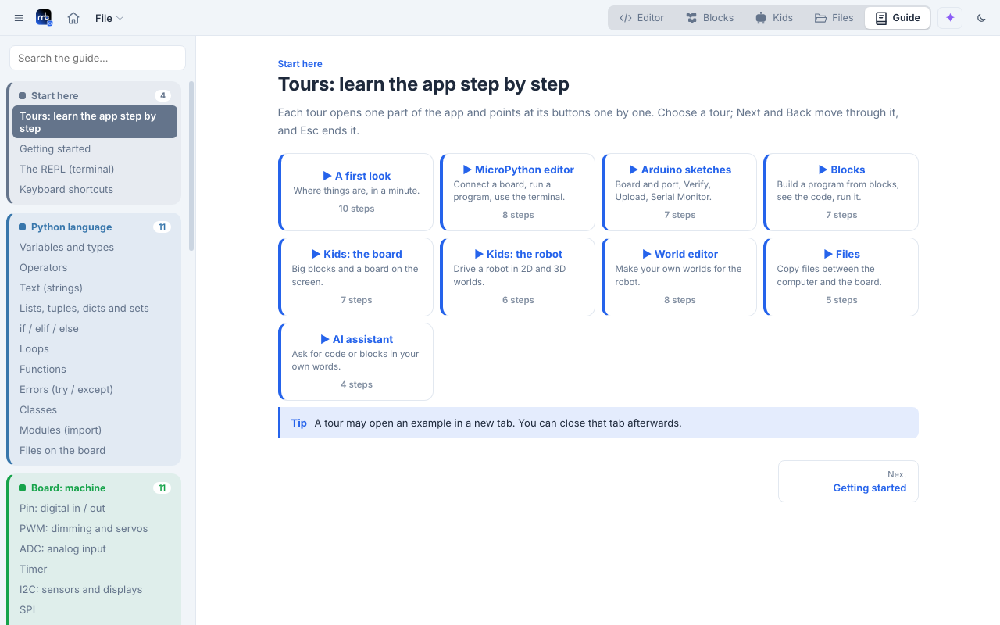

### Light and dark, English and Persian

A clean light theme by default, a dark theme for late nights, and a full Persian interface with
right-to-left layout.

  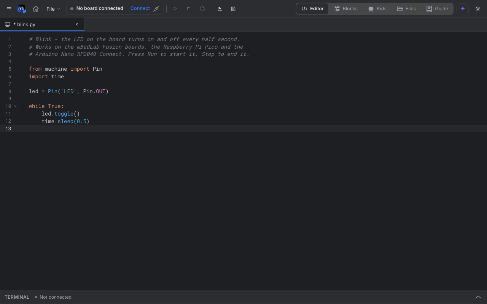

## Supported boards

| Family | Boards |
|---|---|
| **mBedLab Fusion** | Fusion Slim RP20 Connect, RP20 Connect Radio, RP23 Lite, WB55 Lite, H5 Lite |
| **mBedLab Intro** | Nobara R1, Pixel R1 |
| **MicroPython** | Raspberry Pi Pico, Arduino Nano RP2040 Connect and other MicroPython boards |
| **Arduino** | Any board with an Arduino package: AVR, ESP32, STM32, RP2040 and more |

## Requirements

- Windows 10 or 11, 64-bit
- About 250 MB of free disk space
- An internet connection only for installing extra boards, libraries, updates and the AI assistant

## Feedback

Found a problem or have an idea? Open an [issue](../../issues).

## Credits and license

Developed by **Majid Derhambakhsh** at **mBedLab**.

mBedLab Code Studio is based on
[Arduino Lab for MicroPython](https://github.com/arduino/lab-micropython-editor) and is released
under the **GNU AGPL v3.0** license. It includes Blockly (Apache 2.0), three.js (MIT), arduino-cli
(GPL 3.0) and the Vazirmatn font (OFL 1.1).

© 2026 mBedLab
